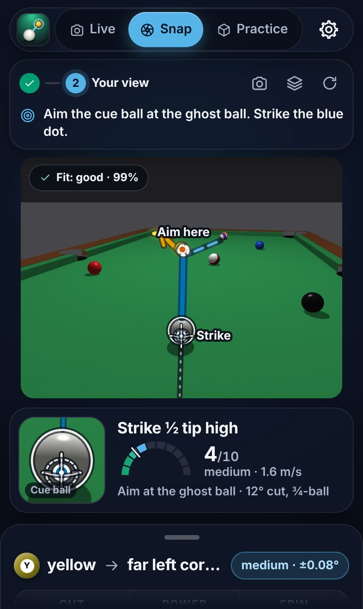
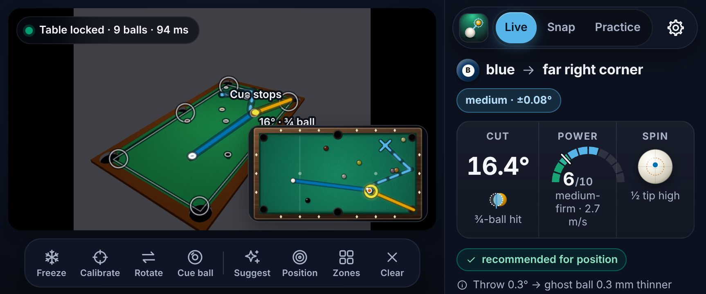
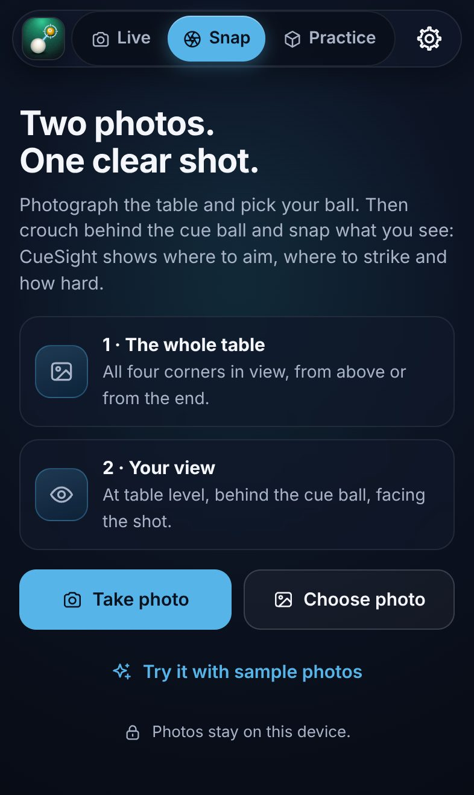

# 🎱 CueSight: a real-time pool & snooker shot trainer in your pocket

Point your phone at a pool or snooker table. CueSight finds the table and the balls. You tap the ball you
want to pocket, and it shows you **exactly how to play it**:

- the aim line and ghost ball, the contact point, the cut angle and the fractional aim every ⅛ of a ball
  (⅞, ¾, ⅝, ½, ⅜…), qualified when the cut is between labels ("a touch thinner than ½-ball")
- throw and squirt corrections in aiming terms ("aim the cue 1.1° to the left of the blue line", "the
  ghost ball is shifted 1.3 mm thinner"); the blue line is where the cue ball travels
- recommended **power** (1–10, a speed word and a pace players can calibrate to: "pocket speed + 2 diamonds")
  and **spin** (the tip drawn on the cue ball's face, as coaches draw it, and in words: "½ tip below
  centre"). One tip is ¼ of the ball radius, about 7 mm on a pool ball, so the 0.5 R miscue limit is
  2 tips; the card details give the offset in mm too. Side spin is only recommended when it clearly
  pays: it adds throw and squirt
- the predicted object-ball and cue-ball paths through cushions, and where the cue ball stops
- a margin of error (millimetres of contact) and difficulty rating, plus a one-line coaching tip ("stun: the cue ball leaves on the
  tangent line, the 90° rule")

All of it runs on your phone. No account, no upload. It also works offline once it has loaded. Three
modes share one planner: **Live** (camera AR), **Snap** (two photos: the table, then your view from behind
the cue ball) and **Practice** (a 3D table you can orbit, drag balls on and replay shots).

| Snap: your view, guided | 3D practice table | Player view | Live camera (landscape) |
|---|---|---|---|
|  |  |  |  |

> The photos and the camera feed in these screenshots are the built-in ray-traced synthetic table. The
> tests use the same images.

## Features

| | |
|---|---|
| **Snap: two-photo guide** | Photograph the whole table, fix the detected layout and pick your ball. Then crouch behind the cue ball and photograph the shot: CueSight works out where you stood and draws the aim line, ghost ball and pocket on your photo, the strike dot on the cue ball's face (high is always above centre), and the power |
| **3D practice table** | WebGL2 table with lamp lighting and glossy numbered balls. Orbit, pinch and pan, presets (Top, Player, Orbit), drag balls, a cue stick showing tip offset and power, and *Play shot* to replay the simulation (also at half speed). Falls back to the 2D table without WebGL2 |
| **Live camera AR** | Detects any cloth colour (grey included) and locks onto the table. Draws the plan in perspective on the cloth, with a top-down mini-map, only while the table is locked. If no cue ball can be told apart, it asks you to tap it |
| **Freeze & calibrate** | Freeze the layout and walk around. Fall back to tapping the four cloth corners. Swap the long and short rails (Rotate). Rotate and Calibrate keep your target, cue ball, pocket and landing spot: they are found again where the camera sees them once the new frame locks ("Kept your selection."). A field-of-view or table change in Settings clears them. Tap *Cue ball* to mark the cue ball, live or frozen. Position mode treats every tap, even next to a ball, as the landing spot |
| **Drills** | No camera needed: built-in practice layouts (straight-in, 30° cut, rail ball, blocked, scratch risk, 9-ball) |
| **Physics-grounded plan** | Time-stepped rigid-ball simulator with sliding/rolling friction, frictional ball–ball impulse (throw), cushions that change top and back spin, and jaws |
| **Bank shots** | When the pocket you picked cannot be played directly (wrong side, or a ball in the way), the card offers *Bank it*: the ball off one cushion into the pocket. The aim comes from simulating the bounce at the stroke's pace and spin, not from the mirror rule, and the card says to treat the line as a starting point |
| **Your stroke** | Power slider and spin pad, plus presets (stun, draw, follow, left, right). Predictions update instantly |
| **Position play** | Tap where the cue ball should finish. CueSight simulates a grid of strokes, rules out any stroke that misses or scratches when hit 6 % or 12 % too hard or too soft, tests the survivors against tip, aim and squirt errors, and recommends the most forgiving one (at most 324 simulations; a phone gets fewer, sized to its speed). If no stroke survives, it says the stroke may need precise pace. Without a target spot it picks the stroke that leaves the easiest next shot |
| **Suggest & zones** | Ranks every makeable shot. Heatmap of cue-ball zones that leave an easy next ball |
| **Tables** | 9-, 8- and 7-ft pool, UK 7-ft and 12-ft snooker. Adjustable cloth speed, cushion bounce and shaft type (standard or low-deflection) |

## Quick start

```bash
cd cuesight
npm install
npm run dev          # http://localhost:5173  (practice table and Snap work in any desktop browser)
npm test             # unit + integration tests (physics, vision accuracy, Snap pose, planner, 3D maths, perf)
npm run fixtures     # renders tests/fixtures/table.y4m (the fake camera) and the Snap photos
npm run e2e          # fixtures + build + Playwright (Chromium; Pixel 7, iPhone SE, iPad): 3D table, Snap, UI, offline, update, live camera
npm run e2e:webkit   # the same flows in WebKit with an iPhone profile (the live-camera and offline specs are skipped)
npm run build        # production PWA in dist/
npm run cap:sync     # build + copy into the iOS project (then: npm run ios:open on a Mac)
```

`npm run e2e` renders the fixtures first. If you run `npx playwright test` yourself, run
`npm run fixtures` once before it: a fresh checkout has no `tests/fixtures/table.y4m` (it is not
committed), and without it `camera.spec.ts` and the Live focus test in `ui.spec.ts` fail at
"Starting camera…". Timing tests can fail on a busy CPU; re-run them alone before concluding.

<!-- RELEASE: update these counts (and the commit) when the release branch is cut. -->
**Test status** (release branch, 2026-11-15): `npx vitest run` runs **1052 tests in 69 files**, all
passing (timing guards compare against work measured in the same run, so a busy CPU does not fail them).
`npm run e2e` runs **141 tests**, all passing, also with a wide fallback font (DejaVu Sans, as on CI).

**On your phone:** browsers only allow the camera on **HTTPS** (or localhost). Deploy `dist/` to any static
HTTPS host (GitHub Pages, Netlify, Cloudflare Pages) and open it on the phone. Then use "Add to Home
Screen" to install it. Use a plain `http://192.168…` LAN address only for the practice table.

**Tips for the best lock:** get the whole cloth in view, stand at an end or a corner, and hold the phone
high. An overhead angle is the most accurate. If the corners are hidden, use **⌖ Calibrate**.

## 3D practice table

| Overview | Player view | Broadcast | Your stroke |
|---|---|---|---|
|  |  |  |  |

Practice opens on a hand-written WebGL2 table (`src/app/render3d/`, no 3D library). Tap a ball, then a
pocket, as before. Drag a ball to move it, drag the cloth to orbit, pinch or scroll to zoom, and use two
fingers to pan. Double-tap the cloth to go back to the last preset. The glass buttons on the right switch
between **Top**, **Player** (eye low behind the cue ball, down the aim line, framed so the pocket stays in
view; the cue takes three slow practice strokes, then rests at address) and **Orbit** (a three-quarter
broadcast angle). A glass label next to the cue ball shows the power (n/10, speed word, 10-segment bar)
and the strike point on a face-on cue ball, in every view. When a shot is too long for the space above
the shot card, Player view keeps the cue ball and the aim line in the middle and lets the far pocket go
out of view. **Clear** leaves the view on the shot just cleared.
**Play** replays the simulated shot in real time (½× plays it at half speed): the cue strikes, and the
balls slide, spin and roll as simulated (a draw shot visibly turns backward) and drop into the pocket.
The balls' motion takes at most 4 s (longer shots are sped up evenly), and the end position is held
for 3.5 s so you can study it. A tap on the table, **Skip** or Escape ends it at once and shows the
planned layout again.

The plan uses the same colours and line styles as everywhere else: aim line, ghost ball, contact point,
object-ball and cue-ball paths, pocket highlight, landing marker and position heatmap. The cue stick sits
behind the cue ball along the cue's own (squirt-corrected) line at the recommended tip offset and is drawn
back further for more power; it is hidden in the top-down view. Without
WebGL2, or with `?renderer=2d`, the 2D table does everything the same way.

## Snap guide

| 1 · The whole table | Fix it, pick your ball | 2 · Your view |
|---|---|---|
|  |  |  |

1. **Photograph the whole table** (the in-app camera, your photo library, or the bundled sample). The 001
   vision pipeline finds the cloth and the balls. The layout appears on the 3D table, and **Photo** shows
   what was detected over your picture. Drag a ball to fix it, use **Cue ball**, **Add** (an unnamed ball on the free spot nearest the middle; drag it into place) or **Remove**,
   or tap the four corners when the table wasn't found. Then tap the ball you want to pocket and, if you
   like, a pocket.
2. **Crouch behind the cue ball** at table level, facing the shot, and take a second photo. CueSight works
   out where the camera was from the known layout (a 6-DoF pose and focal-length fit,
   `src/vision/player-view.ts`, on the cloth, ball circles and cushion edges that
   `src/vision/player-detect.ts` finds). The cloth can be any colour, grey included, and you may
   switch lens between the two photos (0.5×–3×): the table photo's focal length is only a hint. It
   then draws on your photo, in perspective:
   - the aim line on the cloth to the ghost ball (**Aim here**), the object-ball path and the pocket.
     Parts that another ball hides from the camera are dashed and marked "hidden";
   - a bold **strike dot** with a crosshair on the cue ball's face, with the miscue ring and the centre
     cross. A magnified cue ball shows it up close;
   - power 1–10 with a speed word and a gauge, and the spin in words ("Strike ½ tip below centre");
   - how sure it is ("Fit: good · 98 %"), for the target ball the fit was made for.

If the photo can't be lined up, CueSight says why, and the reason decides the next step:
- "The balls seem to have moved": retake the **table** photo. A guide from the old layout would be
  wrong, so the two taps are not offered. This also stops a fit that would otherwise be good, when the
  target, the cue ball or any other ball is no longer where the table photo put it.
- too dark, too grainy, or no table cloth in view: take a better photo (more light, a steadier phone,
  more cloth in view). The two taps are still offered.
- no cue ball found, too few balls (fewer than three ball circles in the photo), or no fit: two taps,
  the cue ball, then the target.

A fit that fails never reports a confidence of 50 % or more. Change the stroke or pocket and the guide
redraws on the same photo. Change the target and the same photo is fitted again (after a two-tap fit
you tap again). If the whole table isn't in the table photo, CueSight asks you to step back and
retake it, or to tap the four corners if they are all in view.

Photos are turned upright from their own orientation tag and scaled to 960 px on the long side
(decoded straight to that size where the browser allows it). Both photos stay in memory on the device. Start over and leaving Snap clear the photo and its
thumbnail, and a photo still being decoded or loaded then is thrown away when it arrives. Of several
photos picked in a row, only the latest is used.

## iOS app

The same web build is wrapped with [Capacitor 8](https://capacitorjs.com/) in `ios/` (dev dependency
only; the web app still has zero runtime dependencies). It needs iOS 16 or later. GitHub Actions on
macOS (`.github/workflows/cuesight-ios.yml`) runs on pushes to `main` and `claude/**` and on pull
requests into `main`. It runs the web checks and the Chromium e2e, builds the app, runs it in the iOS
Simulator with a screenshot tour (the run fails if the app does not report ready within 90 s of a
launch), and runs the Playwright flows in WebKit on an iPhone profile.

**TestFlight** uploads happen only after all four of those jobs pass, and only for a push to `main` or
a manual run with "Upload the build to TestFlight" ticked (it is off by default). Without the App
Store Connect API key secrets, the upload job is skipped with a notice. Setup, secrets, local Mac
builds and troubleshooting are in [`docs/ios.md`](docs/ios.md).

## How it works

```
 camera ─▶ frame grabber (≤640 px, 1 in flight) ─▶ [vision worker]
                                                     cloth colour ▸ table mask ▸ hull ▸ max-area quad ▸ robust side refit
                                                     ▸ homography ▸ focal length from the known rectangle ▸ pose
                                                     ▸ rectify at ball-centre height (parallax-free) ▸ blobs ▸ disc-model count
                                                     ▸ shape gate ▸ colour names ▸ cue pick (none if ambiguous)
                                                     ▸ tracker + lock state machine
                         layout ◀────────────────────┘   (planned and drawn only while the table is locked)
   tap ball/pocket ─▶ planShot()  (main thread, a few ms)
                        pocket window ▸ ghost ball ▸ obstruction checks ▸ throw-compensated aim (impact probes)
                        ▸ full simulation ▸ warnings, margin, coaching tip
                     ─▶ [planner worker] recommendStroke() / suggestShots() / positionHeatmap()
                                         / the full plan with a frozen cue ball's power advice
   render ◀─ AR overlay (H₀ for cloth, H_R for ball centres) + mini-map + shot card
```

- `src/core/` is pure TypeScript: table geometry, physics (`physics/`) and planning (`shot/`).
- `src/vision/` is pure image algorithms on typed arrays, plus `synth/render.ts`, a ray tracer for
  ground-truth fixtures.
- `src/workers/` holds the versioned message protocol and the two workers.
- `src/app/` holds the DOM, camera, rendering and UI.
- `src/app/render3d/` is the WebGL2 table, and `src/app/snap/` is the two-photo flow.
- There are **zero runtime dependencies**.

## How accurate is this?

**Physics.** Each rule below is checked against published results by a unit test (`tests/unit/core`,
`tests/integration`):

| Check | Result |
|---|---|
| 90° rule (stun cut, ideal balls) | Within 0.5° of the tangent line. Real balls (e = 0.95) leave 1–4° forward of it, and the plan shows the real path |
| 30° rule (rolling cue ball) | Within 1° of Alciatore's θ = atan(sinφ·cosφ/(sin²φ+0.4)), peak 33.7° |
| Cut-induced throw | Simulated object-ball departure matches TP A.14 within 0.1°. A slow stun ½-ball hit throws about 4.7° |
| Squirt | Matches TP A.31: 2.4° at ½-R english for a standard shaft, 1.6° for a low-deflection shaft |
| Natural roll / rolling distance | Natural roll from a 2/5 R tip offset. Stopping distance v²/(2μᵣg) within 2 % |
| Cushion | Rolling head-on into a rail, the ball leaves at 0.5–0.65 of its arrival speed (model 0.58; published models: Han 0.54, Mathavan 0.51). A 45° roll-in leaves 30–40° off the rail (model 32°). Draw is not handed back as follow |
| Energy and overlaps | No energy gain across 500 random collisions. No overlaps after a full-rack break |

**Vision.** Measured on ray-traced synthetic tables with exact ground truth, at 640×480 with 4 camera
poses (`tests/unit/vision`, 2026-11-15):

| | End view | Side view | Corner view | Overhead |
|---|---|---|---|---|
| Table corner error | ≤ 0.9 px | ≤ 0.7 px | ≤ 0.6 px | ≤ 0.2 px |
| Ball-centre error, median | 6.3 mm | 1.6 mm | 2.8 mm | 1.1 mm |
| Ball-centre error, max | 18.5 mm | 5.0 mm | 10.7 mm | 2.1 mm |
| Balls found, cue identified | 9/9 ✓ | 9/9 ✓ | 9/9 ✓ | 9/9 ✓ |

The table outline is also tested on blue, red and grey cloth, and ball detection on 4:2:0
chroma-subsampled (video-like) frames, touching clusters, glare and pocket hangers.

**Touching clusters** (3-, 9- and 15-ball racks and a 15-red snooker pack, in every view) are checked
under 62 calibrations each: the table detector's, the camera's exact one, and 60 with the table
corners jittered by ±0.15–1 px, as calibration error. The ball count of a cluster is chosen by a
penalised whole-cluster cost (research.md R-04), so small corner errors no longer swing it. Under all
62 no phantom ball appears next to a cluster. Under the detector's and the exact calibration every
ball that shows at least 25 % of its outline is found (one recorded exception, below), with a median
error ≤ 10 mm and p95 ≤ 25 mm. Balls under 15 % of their outline (the middle of a pack seen from low
down) are allowed to be missed, per view, as a ray cast of the scene counts them.

**Speed** (Node, 2026-11-15, on a shared 4-core machine; a quiet machine is faster). The CI guards
are looser than the device budgets:

| Step | Time | Device budget | CI guard |
|---|---|---|---|
| Vision pipeline per frame (640×480) | ~30–85 ms | — | 150 ms |
| Full shot plan, 22 balls | ~7–20 ms | 50 ms | 100 ms |
| Position search (264 simulations on the test layout; at most 324) | ~0.6 s | 1.5 s | 3 s |
| Snap player-photo fit (960×720) | median ~104 ms, p95 ~250 ms | 1.5 s | p95 < 4 × a successful fit's median and < 500 ms CPU (device budget 250 ms) |

A frame with a snooker pack spends about 10–20 ms more in ball detection than before the cluster fix
(about 45–56 ms against 35–40 ms on Node): a pack seen small is fitted again on a finer window. Pool
frames and frames without a cluster are unchanged or faster.

The physics changed on 2026-11-15: rails now take top and back spin off the ball (research.md R-08), so
the cue ball travels further after a rail at the same power than it did before (up to about a third).
The power scale itself was not changed; R-12 in research.md lists the travel per power level.

### Known limitations (be a sceptical player)

- **Synthetic validation only so far.** Real tables bring glare, worn cloth, people leaning over the
  rail, and phone camera processing. The next milestone is a labelled real-table photo set (see the
  roadmap).
- **Real equipment varies.** Cloth speed, cushion liveliness and pocket cut are user-tunable defaults,
  not measurements of your table. Treat the predicted cue-ball path as guidance with a margin.
- **Cushions.** The rail model applies friction to the full contact slip, so a rail changes top and
  back spin. Next to two published models it puts rail angles within a few degrees and post-rail speed
  within about 10 % (research.md R-08), so the cue-ball path after a rail is the least certain part of
  a plan. Before 2026-11-15 rails kept top and back spin, which under-predicted travel after a rail by
  up to a third.
- **Bank shots.** A bank's aim rests on that rail model, and a bank's pocket window is under a degree
  while the model's rail angles are good to a few. So the line is a starting point to adjust after a
  first try, a bank is never rated easier than "hard", and its tip says so. In the model a soft,
  rolling bank comes off wider than the mirror rule and a firm one close to it, as on a real table.
  Only one cushion, only when you ask for it (*Bank it*), and not for a cue ball frozen to the ball.
  *Suggest* still ranks direct pots only. *Bank it* is on the shot card, not on Snap's own guide panel.
- **Pocket model.** Jaws are modelled as points on the cushion line. Facings, which let balls rattle in,
  are not modelled, so margins are slightly conservative.
- **Assumed stroke.** The cue is assumed level, so there is no swerve or massé. CueSight prescribes the
  stroke; it does not measure yours. Detecting the cue from one handheld camera is unreliable. The
  squirt correction depends on the shaft you pick in Settings (standard or low-deflection).
- **Coaching rules, not physics.** The recommender prefers softer pace (a firm ball meets a smaller
  effective pocket, after Alciatore TP 3.5–3.6), avoids side spin unless it clearly pays, and treats a
  stroke the card would call too soft as a last resort. These weights are tuned heuristics. On a phone
  the search budget is smaller, so the recommended power is usually a whole number and the tip and
  aim error checks may not run; the card then says "Scratch risk from small errors not checked."
- **Frozen balls.** When the cue ball touches the object ball there is no ghost ball: the plan shows
  cut 0, "full" and a stroke angle off the line of centres. The power advice for a frozen ball that is
  hit too softly is checked on the half-step power scale only; powers in between are not checked. On
  snooker a touching ball is never makeable: playing it is a push stroke, a foul.
- **Cue ball.** When the cue ball cannot be told apart (none in view, or two whites too close to call),
  no ball is marked as the cue ball and CueSight asks you to tap it.
- **Ball colours.** Colour names are approximate, and a colour it cannot name is shown as an unnamed
  ball. Solid balls the colour of the cloth are found, but a green stripe on green cloth (the 14) is
  lost in most video frames when its stripe faces the camera, and in far views on video frames it can
  still be flagged as the cue ball (1 of 216 jittered runs). A green stripe on green cloth (or a blue
  one on blue) lying frozen just inside a cushion can likewise read as a white ball and be flagged as
  the cue ball, mostly in views from a corner (about 1 in 120 such frames).
- **Grey cloth.** The table is found on grey cloth, but on mid or light grey cloth the white cue ball
  and light stripes may not be detected in Live frames or the Snap table photo. Tap *Cue ball* to mark
  the cue ball, or add the missing ball in the Snap review.
- **Clusters.** A ball hidden inside its neighbours' outline (under about 15 % of its outline its own)
  cannot be counted. With a slightly wrong calibration (some of 60 jittered calibrations per scene,
  ±0.15–1 px corners) the end views lose one more ball that shows 28–56 % of its outline (in 6–11 of
  60: a pool pack's green 6 or black 8, a snooker end ball in the second row), and the snooker corner
  views reach a median error of 10–12 mm (5–6 of 60). Under the exact calibration the 15-ball end view
  misses the green 6 (29 % of its outline, green on green; the recorded exception).
- **Snooker packs on video frames.** Seen from an end or a corner on 4:2:0 video, a snooker pack has
  about one colour sample per ball radius: 3–5 reds are lost or misplaced by 25–40 mm (median error
  15–18 mm), and phantom reds can appear next to the pack (fewer than with the earlier detector). On
  960-px Snap frames taken from video with smoothly upsampled colour, the snooker end view loses a red
  that shows 28 % of its outline in 5 of 6 calibrations.
- **Pocket holes.** With calibration error a pocket's dark hole can fall outside its masked throat and
  read as a dark ball in the pocket, away from every ball: rarely at ±0.3–0.5 px corner error (2 of
  1798 runs), more often at ±1–2 px.
- **Corner pockets out of view.** The table can lock with a corner just off the screen; the status then
  reads "Table locked — a corner pocket is out of view", and balls in that pocket may be missed.
- **Snap.** The player-photo fit assumes a pinhole camera, a photo taken at table level (5–50 cm above
  the cloth, within about 1.5 m of the cue ball, held roughly level) and balls that did not move between
  the two photos. It is validated on synthetic photos only so far: over 912 photos across that range
  (8–40 cm up, 0.3–1.2 m back, ±15° off the line, 40–100° lenses) that show the cue ball and two more
  balls, about 95 % line up within tolerance, and none reports a fit that is far off (spec 002
  SC-106, SC-107). Known gaps:
  - untinted grey cloth (tint S ≤ 0.06): the cue ball's shaded side has the cloth's own grey, so the
    photo lines up in about 30 % of cases; otherwise CueSight asks for the two taps, which work;
  - a charcoal cloth in a dark grey room may read "I can't find the table cloth";
  - a target camouflaged in the cloth (green on green) cannot trigger "The balls seem to have moved"
    when it moves or is pocketed;
  - on a tiny cue ball the strike dot of a fit that is otherwise right can, rarely, be about 0.2 R off;
  - a few photos say "moved" when nothing moved (1 of 77 on untinted grey cloth; 2 from 8 cm up with
    a 100° lens);
  - a photo without the cue ball is not yet fitted from the other balls: it fails with "I can't find
    the cue ball" (or "I couldn't line up this photo"); retake it with the cue ball in view;
  - very low ultra-wide photos (5–9 cm up, 90–100° lens) that show only 2–3 balls ask for the two taps
    more often: there the side and end cushions look like one line, so they no longer count as a check
    on the pose;
  - a target moved along your line of sight by less than about 0.4 of its radius in the photo (about
    12 cm from a low camera far from it) is not detected as "moved".
- **Snap with a dark, grainy or cloth-less photo.** The two taps are offered once on a dark or grainy
  photo; if they do not line it up either, CueSight says so and asks for a better photo. With no cloth
  in view, it asks for a new photo straight away.
- **Ball identity and rules.** Planning is rule-agnostic: any object ball can be the target.
- **Out of scope for now.** Kick shots (cue ball off a cushion first), banks off two or more cushions,
  and combination shots.

## Built with spec-driven development

This project was built with **[GitHub Spec Kit](https://github.com/github/spec-kit)**. The artifacts are
part of the repo:

1. [`docs/market-analysis.md`](docs/market-analysis.md): who already does what (DrillRoom, AimPool,
   Bricole, CueScope, FusionCue…) and the gap.
2. [`docs/MASTER_PROMPT.md`](docs/MASTER_PROMPT.md): the build prompt, written from two viewpoints (a
   principal CV architect and a pro player/coach). It covers mission, MoSCoW scope, physics ground truth,
   budgets, method and definition of done.
3. [`.specify/memory/constitution.md`](.specify/memory/constitution.md): 7 principles, including physics
   fidelity, honest uncertainty, test-first, real-time budget and privacy by architecture.
4. [`specs/001-realtime-shot-guide/`](specs/001-realtime-shot-guide/):
   - [spec](specs/001-realtime-shot-guide/spec.md) with prioritised user stories
   - [plan](specs/001-realtime-shot-guide/plan.md) and [research decisions](specs/001-realtime-shot-guide/research.md)
   - [data model](specs/001-realtime-shot-guide/data-model.md) and [contracts](specs/001-realtime-shot-guide/contracts/)
   - [quickstart](specs/001-realtime-shot-guide/quickstart.md)
   - [tasks](specs/001-realtime-shot-guide/tasks.md): all done, T074 (the touching-cluster vision fix)
     last
   - [analysis](specs/001-realtime-shot-guide/analysis.md), with the post-review status
5. [`specs/002-3d-visual-ios/`](specs/002-3d-visual-ios/): the 3D table, Snap, the Midnight Felt design
   and the iOS app ([spec](specs/002-3d-visual-ios/spec.md), [plan](specs/002-3d-visual-ios/plan.md),
   [contracts](specs/002-3d-visual-ios/contracts/), [tasks](specs/002-3d-visual-ios/tasks.md),
   [analysis](specs/002-3d-visual-ios/analysis.md)).

The Spec Kit skills (`/speckit-specify`, `/speckit-plan`, `/speckit-tasks`, `/speckit-implement`…) are
installed in `.claude/skills` for the next feature.

## Roadmap

1. Real-table dataset and evaluation harness. An optional learned ball detector behind the same
   `detectBalls` contract (ONNX Runtime Web).
2. Kick shots, two-cushion banks and combinations (one-cushion banks are in: simulated, not the
   mirror system). Banks in *Suggest*.
3. Shot-result tracking: record the actual paths after the stroke, compare them with the prediction,
   and auto-calibrate cloth and cushions.
4. Rule-aware suggestions for 8-ball, 9-ball and snooker (ball numbers and colours).
5. Drills with scoring. Snap "live" mode: keep the guide on the camera view after the first fit.

## Privacy

Camera frames and Snap photos are processed in a Web Worker on your device and never stored or
transmitted. Apart from its own files (including the bundled sample photos, from its own site and,
once installed, from the offline cache), the app makes no network requests. Settings live in your
browser's local storage.

**Offline and updates.**
- On the first visit the service worker precaches the whole build: the shell, every JS and CSS chunk,
  both worker scripts, the icons, the manifest and the Snap sample photos. The list is written into
  `sw.js` at build time by `scripts/sw-precache.ts`. No source maps ship. After that the app starts and
  plans with no network at all.
- An install revalidates every file with the server instead of trusting the browser's HTTP cache, and
  refuses a version whose `index.html` references another build's files (a half-propagated deploy). It
  tries again on the next update check.
- The build id hashes every listed file's bytes, so a new sample photo, manifest or icon is a new
  version even when its file name is unchanged.
- A new version never takes over an open page. The page says "A new version of CueSight is ready." with
  **Reload**; otherwise the new version starts once every tab of the old one is closed.
- `tests/e2e/offline.spec.ts` checks zero requests to any other origin, then an offline reload, a plan,
  a Snap table photo and a cold start in a new tab. `tests/e2e/update.spec.ts` checks that an open page
  keeps working across a deploy and updates only when asked.

## References

- D. Alciatore, *The Illustrated Principles of Pool and Billiards*, plus the technical proofs (TP A.14
  throw, TP A.31 squirt), billiards.colostate.edu
- W. Marlow, *The Physics of Pocket Billiards*
- E. Kiefl, *pooltool* (billiards simulation)
- Z. Zhang, "A Flexible New Technique for Camera Calibration" (focal length from a planar rectangle)
