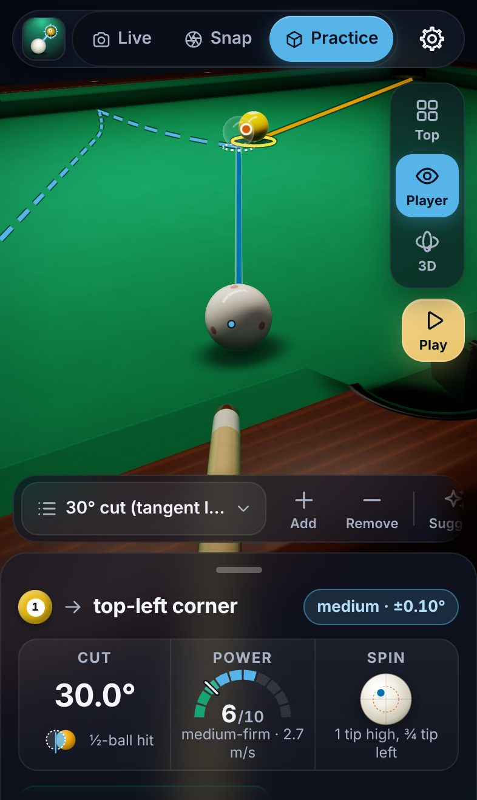
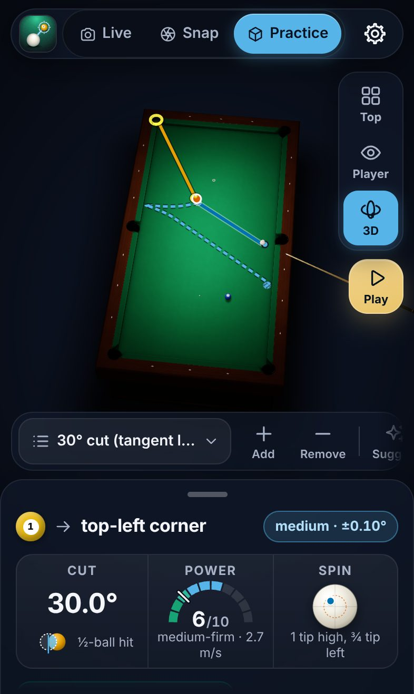
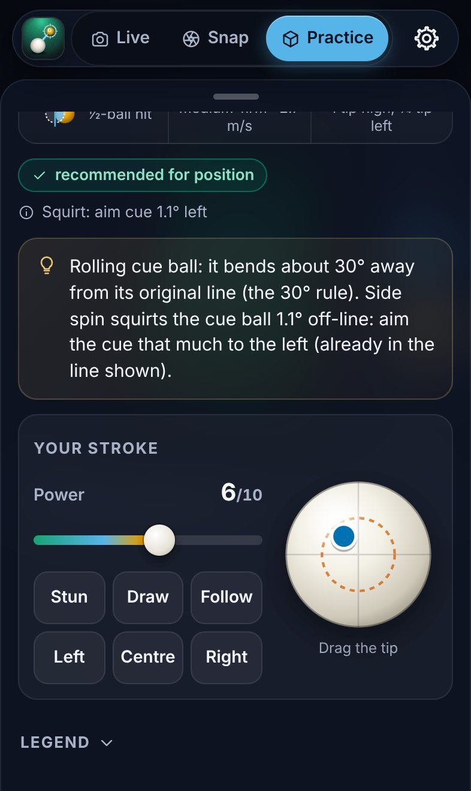
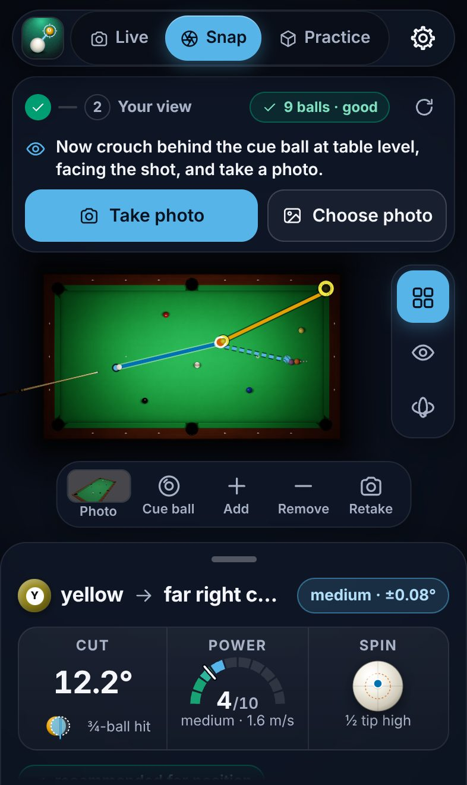

# 🎱 CueSight: a real-time pool & snooker shot trainer in your pocket

Point your phone at a pool or snooker table. CueSight finds the table and the balls. You tap the ball you
want to pocket, and it shows you **exactly how to play it**:

- the aim line and ghost ball, the contact point, the cut angle and the fractional aim (½-ball, ¾-ball…)
- throw and squirt corrections in degrees and millimetres
- recommended **power** (1–10 plus a speed word) and **spin** (tip position on a cue-ball diagram)
- the predicted object-ball and cue-ball paths through cushions, and where the cue ball stops
- a margin of error and difficulty rating, plus a one-line coaching tip ("stun: the cue ball leaves on the
  tangent line, the 90° rule")

All of it runs on your phone. No account, no upload. It also works offline once it has loaded. Three
modes share one planner: **Live** (camera AR), **Snap** (two photos: the table, then your view from behind
the cue ball) and **Practice** (a 3D table you can orbit, drag balls on and replay shots).

| Snap: your view, guided | 3D practice table | Player view | Live camera (landscape) |
|---|---|---|---|
|  |  |  |  |

> The photos and the camera feed in these screenshots are the built-in ray-traced synthetic table. The
> tests use the same images.

## Features

| | |
|---|---|
| **Snap: two-photo guide** | Photograph the whole table, fix the detected layout and pick your ball. Then crouch behind the cue ball and photograph the shot: CueSight works out where you stood and draws the aim line, ghost ball and pocket on your photo, the strike dot on the cue ball, and the power |
| **3D practice table** | WebGL2 table with lamp lighting and glossy numbered balls. Orbit, pinch and pan, presets (top, player's eye, broadcast), drag balls, a cue stick showing tip offset and power, and *Play shot* to replay the simulation. Falls back to the 2D table without WebGL2 |
| **Live camera AR** | Detects any cloth colour automatically and locks onto the table. Draws the plan in perspective on the cloth, with a top-down mini-map |
| **Freeze & calibrate** | Freeze the layout and walk around. Fall back to tapping four corners. Swap the long and short rails. Tap the cue ball if it wasn't found |
| **Drills** | No camera needed: built-in practice layouts (straight-in, 30° cut, rail ball, blocked, scratch risk, 9-ball) |
| **Physics-grounded plan** | Time-stepped rigid-ball simulator with sliding/rolling friction, frictional ball–ball impulse (throw), cushions and jaws |
| **Your stroke** | Power slider and spin pad, plus presets (stun, draw, follow, left, right). Predictions update instantly |
| **Position play** | Tap where the cue ball should finish. CueSight searches about 170 strokes and recommends the most forgiving one. Without a target spot it picks the stroke that leaves the easiest next shot |
| **Suggest & zones** | Ranks every makeable shot. Heatmap of cue-ball zones that leave an easy next ball |
| **Tables** | 9-, 8- and 7-ft pool, UK 7-ft and 12-ft snooker. Adjustable cloth speed, cushion bounce and shaft type (standard or low-deflection) |

## Quick start

```bash
cd cuesight
npm install
npm run dev          # http://localhost:5173  (practice table and Snap work in any desktop browser)
npm test             # unit + integration tests (physics, vision accuracy, Snap pose, planner, 3D maths, perf)
npm run e2e          # Playwright (Chromium; Pixel 7, iPhone SE, iPad): 3D table, Snap, 2D fallback, offline, size budget, live camera
npm run e2e:webkit   # the same flows in WebKit with an iPhone profile
npm run build        # production PWA in dist/
npm run cap:sync     # build + copy into the iOS project (then: npm run ios:open on a Mac)
```

**On your phone:** browsers only allow the camera on **HTTPS** (or localhost). Deploy `dist/` to any static
HTTPS host (GitHub Pages, Netlify, Cloudflare Pages) and open it on the phone. Then use "Add to Home
Screen" to install it. Use a plain `http://192.168…` LAN address only for the practice table.

**Tips for the best lock:** get the whole cloth in view, stand at an end or a corner, and hold the phone
high. An overhead angle is the most accurate. If the corners are hidden, use **⌖ Calibrate**.

## 3D practice table

| Overview | Player view | Broadcast | Your stroke |
|---|---|---|---|
|  |  |  |  |

Practice opens on a hand-written WebGL2 table (`src/app/render3d/`, no 3D library). Tap a ball, then a
pocket, as before. Drag a ball to move it, drag the cloth to orbit, pinch or scroll to zoom, and use two
fingers to pan. Double-tap the cloth to go back to the last preset. The glass buttons on the right switch
between **Top**, **Player** (eye low behind the cue ball, down the aim line) and **3D** (broadcast angle).
**Play** replays the simulated shot in real time: the cue strikes, and the balls roll with the right
rotation and drop into the pocket. Tap, **Skip** or Escape ends it.

The plan uses the same colours and line styles as everywhere else: aim line, ghost ball, contact point,
object-ball and cue-ball paths, pocket highlight, landing marker and position heatmap. The cue stick sits
behind the cue ball at the recommended tip offset and is drawn back further for more power. Without
WebGL2, or with `?renderer=2d`, the 2D table does everything the same way.

## Snap guide

| 1 · The whole table | Fix it, pick your ball | 2 · Your view |
|---|---|---|
|  |  |  |

1. **Photograph the whole table** (the in-app camera, your photo library, or the bundled sample). The 001
   vision pipeline finds the cloth and the balls. The layout appears on the 3D table, and **Photo** shows
   what was detected over your picture. Drag a ball to fix it, use **Cue ball**, **Add** or **Remove**,
   or tap the four corners when the table wasn't found. Then tap the ball you want to pocket and, if you
   like, a pocket.
2. **Crouch behind the cue ball** at table level, facing the shot, and take a second photo. CueSight works
   out where the camera was from the known layout (a 6-DoF pose and focal-length fit,
   `src/vision/player-view.ts`) and draws on your photo, in perspective:
   - the aim line on the cloth to the ghost ball (**Aim here**), the object-ball path and the pocket;
   - a bold **strike dot** with a crosshair on the cue ball's face, with the miscue ring and the centre
     cross. A magnified cue ball shows it up close;
   - power 1–10 with a speed word and a gauge, and the spin in words ("Strike ½ tip low");
   - how sure it is ("Fit: good · 98 %").

If the photo can't be lined up, CueSight says why and asks for two taps: the cue ball, then the target.
Change the stroke, target or pocket and the guide redraws on the same photo. Both photos stay in memory
on the device and are dropped when you start over or leave Snap.

## iOS app

The same web build is wrapped with [Capacitor 8](https://capacitorjs.com/) in `ios/` (dev dependency
only; the web app still has zero runtime dependencies). GitHub Actions on macOS
(`.github/workflows/cuesight-ios.yml`) builds it, runs it in the iOS Simulator with a screenshot tour,
and runs the Playwright flows in WebKit on an iPhone profile. When the App Store Connect API key secrets
are set, it archives a signed build and uploads it to **TestFlight**. Setup, secrets and local Mac builds
are in [`docs/ios.md`](docs/ios.md).

## How it works

```
 camera ─▶ frame grabber (≤640 px, 1 in flight) ─▶ [vision worker]
                                                     cloth colour ▸ table mask ▸ hull ▸ max-area quad ▸ robust side refit
                                                     ▸ homography ▸ focal length from the known rectangle ▸ pose
                                                     ▸ rectify at ball-centre height (parallax-free) ▸ blobs ▸ k-means split
                                                     ▸ cue-ball scoring ▸ tracker + lock state machine
                         layout ◀────────────────────┘
   tap ball/pocket ─▶ planShot()  (main thread, ~5–10 ms)
                        pocket window ▸ ghost ball ▸ obstruction checks ▸ throw-compensated aim (impact probes)
                        ▸ full simulation ▸ warnings, margin, coaching tip
                     ─▶ [planner worker] recommendStroke() / suggestShots() / positionHeatmap()
   render ◀─ AR overlay (H₀ for cloth, H_R for ball centres) + mini-map + shot card
```

- `src/core/` is pure TypeScript: table geometry, physics (`physics/`) and planning (`shot/`).
- `src/vision/` is pure image algorithms on typed arrays, plus `synth/render.ts`, a ray tracer for
  ground-truth fixtures.
- `src/workers/` holds the versioned message protocol and the two workers.
- `src/app/` holds the DOM, camera, rendering and UI.
- `src/app/render3d/` is the WebGL2 table, and `src/app/snap/` is the two-photo flow.
- There are **zero runtime dependencies**.

## How accurate is this?

**Physics.** Each rule below is checked against published results by a unit test (`tests/unit/core`,
`tests/integration`):

| Check | Result |
|---|---|
| 90° rule (stun cut, ideal balls) | Within 0.5° of the tangent line. Real balls (e = 0.95) leave 1–4° forward of it, and the plan shows the real path |
| 30° rule (rolling cue ball) | Within 1° of Alciatore's θ = atan(sinφ·cosφ/(sin²φ+0.4)), peak 33.7° |
| Cut-induced throw | Simulated object-ball departure matches TP A.14 within 0.1°. A slow stun ½-ball hit throws about 4.7° |
| Squirt | Matches TP A.31: 2.4° at ½-R english for a standard shaft, 1.6° for a low-deflection shaft |
| Natural roll / rolling distance | Natural roll from a 2/5 R tip offset. Stopping distance v²/(2μᵣg) within 2 % |
| Energy and overlaps | No energy gain across 500 random collisions. No overlaps after a full-rack break |

**Vision.** Measured on ray-traced synthetic tables with exact ground truth, at 640×480 with 4 camera
poses (`tests/unit/vision`):

| | End view | Side view | Corner view | Overhead |
|---|---|---|---|---|
| Table corner error | < 1 px | < 1 px | < 1 px | 1.3 px |
| Ball-centre error, median | 4.1 mm | 1.8 mm | 3.4 mm | 3.1 mm |
| Ball-centre error, max | 16.9 mm | 6.4 mm | 10.7 mm | 6.6 mm |
| Balls found, cue identified | 9/9 ✓ | 9/9 ✓ | 9/9 ✓ | 9/9 ✓ |

The table outline is also tested on blue and red cloth, and ball detection on 4:2:0 chroma-subsampled
(video-like) frames.

**Speed** (Node, laptop CPU):

| Step | Time | Budget |
|---|---|---|
| Vision pipeline per frame | ~40–60 ms | — |
| Full shot plan, 22 balls | ~7–10 ms | 50 ms |
| Position search (~170 simulated strokes) | ~0.3 s | 1.5 s |

### Known limitations (be a sceptical player)

- **Synthetic validation only so far.** Real tables bring glare, worn cloth, people leaning over the
  rail, and phone camera processing. The next milestone is a labelled real-table photo set (see the
  roadmap).
- **Real equipment varies.** Cloth speed, cushion liveliness and pocket cut are user-tunable defaults,
  not measurements of your table. Treat the predicted cue-ball path as guidance with a margin.
- **Pocket model.** Jaws are modelled as points on the cushion line. Facings, which let balls rattle in,
  are not modelled, so margins are slightly conservative.
- **Assumed stroke.** The cue is assumed level, so there is no swerve or massé. CueSight prescribes the
  stroke; it does not measure yours. Detecting the cue from one handheld camera is unreliable.
- **Ball identity.** Ball identity is colour-based and approximate, and the cue ball is the reliable
  one. A green ball on green cloth can be missed. Planning is rule-agnostic: any object ball can be the
  target.
- **Out of scope for now.** Bank, kick and combination shots.

## Built with spec-driven development

This project was built with **[GitHub Spec Kit](https://github.com/github/spec-kit)**. The artifacts are
part of the repo:

1. [`docs/market-analysis.md`](docs/market-analysis.md): who already does what (DrillRoom, AimPool,
   Bricole, CueScope, FusionCue…) and the gap.
2. [`docs/MASTER_PROMPT.md`](docs/MASTER_PROMPT.md): the build prompt, written from two viewpoints (a
   principal CV architect and a pro player/coach). It covers mission, MoSCoW scope, physics ground truth,
   budgets, method and definition of done.
3. [`.specify/memory/constitution.md`](.specify/memory/constitution.md): 7 principles, including physics
   fidelity, honest uncertainty, test-first, real-time budget and privacy by architecture.
4. [`specs/001-realtime-shot-guide/`](specs/001-realtime-shot-guide/):
   - [spec](specs/001-realtime-shot-guide/spec.md) with prioritised user stories
   - [plan](specs/001-realtime-shot-guide/plan.md) and [research decisions](specs/001-realtime-shot-guide/research.md)
   - [data model](specs/001-realtime-shot-guide/data-model.md) and [contracts](specs/001-realtime-shot-guide/contracts/)
   - [quickstart](specs/001-realtime-shot-guide/quickstart.md)
   - [tasks](specs/001-realtime-shot-guide/tasks.md), all done
   - [analysis](specs/001-realtime-shot-guide/analysis.md)
5. [`specs/002-3d-visual-ios/`](specs/002-3d-visual-ios/): the 3D table, Snap, the Midnight Felt design
   and the iOS app ([spec](specs/002-3d-visual-ios/spec.md), [plan](specs/002-3d-visual-ios/plan.md),
   [contracts](specs/002-3d-visual-ios/contracts/), [tasks](specs/002-3d-visual-ios/tasks.md)).

The Spec Kit skills (`/speckit-specify`, `/speckit-plan`, `/speckit-tasks`, `/speckit-implement`…) are
installed in `.claude/skills` for the next feature.

## Roadmap

1. Real-table dataset and evaluation harness. An optional learned ball detector behind the same
   `detectBalls` contract (ONNX Runtime Web).
2. Bank and kick shots (mirror system plus simulated correction), and combinations.
3. Shot-result tracking: record the actual paths after the stroke, compare them with the prediction,
   and auto-calibrate cloth and cushions.
4. Rule-aware suggestions for 8-ball, 9-ball and snooker (ball numbers and colours).
5. Drills with scoring. Snap "live" mode: keep the guide on the camera view after the first fit.

## Privacy

Camera frames and Snap photos are processed in a Web Worker on your device and never stored or
transmitted. The app makes no network requests after it loads. On the first visit the service worker
precaches the whole build (the list of built files is written into `sw.js` at build time by
`scripts/sw-precache.ts`), so the app then starts and plans with no network at all.
`tests/e2e/offline.spec.ts` checks this: zero requests to any other origin, then an offline reload, a
plan, a Snap table photo and a cold start in a new tab. Settings live in your browser's local storage.

## References

- D. Alciatore, *The Illustrated Principles of Pool and Billiards*, plus the technical proofs (TP A.14
  throw, TP A.31 squirt), billiards.colostate.edu
- W. Marlow, *The Physics of Pocket Billiards*
- E. Kiefl, *pooltool* (billiards simulation)
- Z. Zhang, "A Flexible New Technique for Camera Calibration" (focal length from a planar rectangle)
